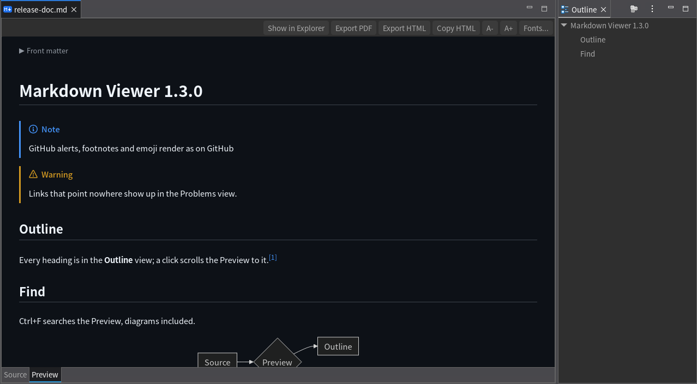
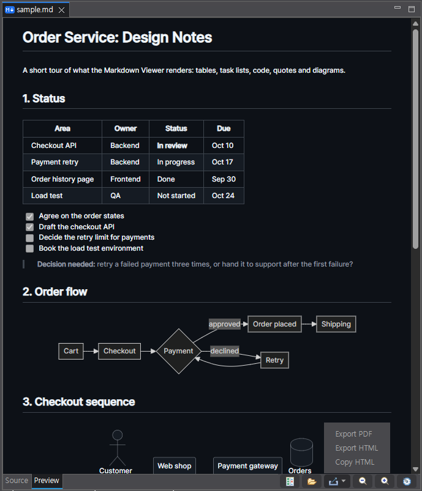

# Markdown Viewer for Eclipse

A Markdown editor for Eclipse with a preview tab.
Source and Preview are tabs of one editor, not a split screen or a separate view, so the document gets the whole editor area and a terminal or other views keep their room beside it.
It renders GitHub Flavored Markdown with the same parser VS Code uses (markdown-it), draws Mermaid and PlantUML diagrams and math, keeps the source and the preview at the same scroll position, and exports PDF and HTML from one menu.

[한국어 README](README.ko.md)

| Source tab | Preview tab, dark theme | Preview tab, light theme |
|---|---|---|
|  |  |  |

| Dark theme | Light theme (also used for PDF) |
|---|---|
|  |  |






The screenshots show [docs/sample.md](docs/sample.md) with the default settings, the math one [test/math.md](test/math.md).

## Features

| Feature | Details |
|---|---|
| Tabs | Source and Preview tabs in one editor area, each using its full width with no split screen, opening on Preview by default |
| Toolbar | Buttons at the right end of the Source / Preview tab row, with Eclipse's icons and tooltips: Side by side, Show in Explorer, Export ▾ (Export PDF, Export HTML, Copy HTML), Smaller / Larger text and Settings. The Export menu opens upwards in the theme's colors. On a narrow editor the buttons move below the tabs |
| Outline | The Outline view (Window > Show View > Outline) lists the headings as a tree; a click moves the Source caret and the Preview to the heading. Headings in code blocks and front matter are left out |
| Scroll sync | Switching tabs keeps the scrollbar position: at the bottom of one means at the bottom of the other. A double-click in the Preview opens the Source tab at the line of that paragraph, table row, list item or diagram |
| Side by side | The `Side by side` button (tab row and main toolbar) puts the Source on the left and the Preview on the right with Eclipse's split editor; the two follow each other by line, a double-click in the Preview moves the Source caret there, and a second press joins them again. Ctrl+_ / Ctrl+{ (Eclipse's split keys) work on the Preview tab too. The button is the command `Show Source and Preview side by side`, which has no default key: bind one under Preferences > General > Keys |
| Rendering | GFM tables, task lists, syntax highlighting, heading anchors (table of contents links) |
| Front matter | A YAML block at the top of the file (`---` to `---`), as in SKILL.md files or static site pages, shows as a collapsed key/value table instead of a rule and bold text |
| GitHub syntax | Alerts (`> [!NOTE]`, `[!TIP]`, `[!IMPORTANT]`, `[!WARNING]`, `[!CAUTION]`) in GitHub's colors, footnotes (`[^1]`), emoji shortcodes (`:smile:`) |
| Obsidian callouts | `> [!info]`, `[!todo]`, `[!faq]`, `[!bug]` and the other Obsidian types and aliases, with an own title (`> [!tip] My title`) and folding (`[!faq]-` collapsed, `[!faq]+` open); an unknown type shows as a note. The five GitHub types written alone keep GitHub's look |
| Wikilinks | `[[note]]`, `[[note#Heading]]`, `[[note\|label]]` and `[[#Heading]]`, as in an Obsidian vault or an AI-written "LLM wiki": a name is looked up anywhere in the project (the document's folder first, then the shortest path), a path with `/` from the project root. `![[image.png]]` and `![[image.png\|300]]` show the image. A link to a missing page shows dimmed with a dashed underline |
| Obsidian text | `==highlight==` in a marker color, `%%comment%%` (inline, or `%%` lines around a block) not shown, `#tag` as a small rounded label (not `#123`, not in code or links) |
| Backlinks | At the end of the Preview, the other Markdown files of the project that link to the document (by wikilink or relative link), each with the lines that do, a click opens it. Found in the background, updated when a Markdown file is saved; not in the PDF / HTML export. Can be switched off in the preferences |
| Mermaid | ```` ```mermaid ```` blocks, with tighter default spacing and the preview's font |
| Diagram zoom | Ctrl+wheel over a Mermaid diagram zooms around the pointer, dragging moves it, Original size goes back |
| Code blocks | A Copy button (shown on hover) copies the code as written |
| PlantUML | ```` ```plantuml ```` / ```` ```puml ```` blocks, drawn locally by the bundled PlantUML, no server, no Graphviz |
| Math | `$inline$`, `$$display$$` and ```` ```math ```` blocks as on GitHub, drawn offline by the bundled KaTeX; `\$` and prices such as $5 stay text, a TeX error shows in red |
| Images | PNG, GIF and SVG relative to the document, inline `<svg>`. Pasting a screenshot (an image alone on the clipboard) in the Source tab saves it as `images/image-<date>-<time>.png` next to the document and inserts the link |
| Links | `.md`, `.markdown`, `.mdown`, `.mkd` links open in Eclipse, web and mail links in the system browser |
| PDF export | A4, light colors, diagrams and math included, printed by headless Edge (Windows) or Chrome / Chromium (Linux) |
| HTML | Export HTML saves one file (the preview as drawn, diagrams as SVG, styles inline, KaTeX fonts inside; local images are linked relative to the saved file, so keep them beside it); Copy HTML (also in the Preview context menu) puts it on the clipboard with every element's look in `style=""`, for mail, wikis and blog editors |
| Live reload | Typing updates the Preview in place: only the blocks that changed are drawn again, so diagrams elsewhere stay and the page keeps its place. When the file changes on disk, for example written by an AI coding agent such as Claude Code or Codex CLI in a terminal, the Preview re-renders it within 0.3 s, diagrams included. Eclipse notices the change right away with Preferences > General > Workspace > Refresh using native hooks or polling; with unsaved edits in the editor, Eclipse asks before reloading |
| Source editing | Enter continues list items, task lists and quotes (an empty item ends the list), Tab nests a list item; a backtick gets its pair, ```` ``` ```` + Enter closes the code fence; Tab in a table moves to the next cell and lines up the columns (wide CJK characters count as two), Enter adds a row, Shift+Tab goes back a cell. Ctrl+B / Ctrl+I mark the selection or word bold / italic (again to remove), Ctrl+K makes it a link, and a web address pasted over selected text becomes `[text](address)`. Needs TM4E, as in the Eclipse IDE packages |
| Folding | Heading sections, fenced code, front matter, HTML comments, tables, longer quotes and list items with nested items fold in the Source. When a Markdown language server (such as Wild Web Developer's) folds the document, its folds are used instead, never both |
| Source links | Ctrl+click follows links, images, reference links, `#anchors` (to the heading), `file.md#anchor` and wikilinks; content assist after `](`, `[label]:` and `#` offers files, folders and headings, after `][` the defined labels, after `[[` the files of the project (closing the `]]`), after `[[note#` its headings, and after a code fence the languages |
| Bookmarks | Optional (off by default), in every text editor: Alt+F2 toggles a bookmark, F2 / Shift+F2 go to the next / previous one, Alt+0-9 set a quick bookmark and Alt+Shift+0-9 go to it. They are Eclipse's own bookmarks (Bookmarks view), shown as ribbons on the Preview too, where the same keys work. Off, F2 and Shift+F2 do what they did before |
| Find | Ctrl+F on the Preview tab opens a find bar: all matches highlighted (diagram text too), Enter / Shift+Enter or F3 / Shift+F3 for next / previous, the count, Esc to close. On the Source tab Ctrl+F stays Eclipse's Find/Replace |
| Link check | Broken document-relative links, images, `#anchors` (headings, `id`/`name` in HTML) and wikilinks (missing page or heading) of an open workspace file show as warnings in the Problems view; web links and absolute or network paths are not looked at |
| Font size | `Smaller text` / `Larger text` buttons in the tab row |
| Preferences | Fonts, line height, letter spacing, line breaks, dark and light colors (GitHub colors by default), diagram spacing, optional bookmark keys and double-click to close editor tabs |
| Offline | All JavaScript and PlantUML are inside the plugin JAR |
| Languages | English, Korean |

The Source tab is Eclipse's Generic Editor, so TM4E syntax highlighting and the Wild Web Developer Markdown language server keep working.

## Requirements

- Eclipse 2026-09 (4.41) or later with `org.eclipse.ui.genericeditor` (included in the Eclipse IDE packages)
- Windows 10 or 11 with Microsoft Edge (WebView2): everything, including the PDF export
- Linux: the preview works with WebKitGTK (`libwebkit2gtk-4.1`), checked on Ubuntu 24.04 under WSL; the PDF export uses Google Chrome or Chromium found on `PATH` (`google-chrome`, `google-chrome-stable`, `chromium-browser`, `chromium`, `microsoft-edge`), checked with Google Chrome under WSL

## Install

**Eclipse Marketplace:** drag the button onto a running Eclipse, or search for "Markdown Viewer" in Help > Eclipse Marketplace ([listing](https://marketplace.eclipse.org/content/markdown-viewer)).

[](https://marketplace.eclipse.org/marketplace-client-intro?mpc_install=7567639 "Drag to your running Eclipse workspace to install Markdown Viewer")

**Update site** (Eclipse can then update it with Help > Check for Updates):

1. Help > Install New Software > Work with: `https://insjang.github.io/eclipse-markdown-viewer/updates/` and press Enter.
2. Check **Markdown Viewer**, Next, accept the license, Finish.
   The plugin is not code-signed, so Eclipse asks whether to trust unsigned content: choose Trust Selected.
3. Restart Eclipse. `.md` files now open in the Markdown Viewer.

**Or a single JAR, no p2:**

1. Download `io.github.insjang.mdviewer_<version>.jar` from [Releases](https://github.com/insjang/eclipse-markdown-viewer/releases).
2. Close Eclipse and copy the JAR into the `dropins` folder of your Eclipse installation.
3. Start Eclipse.

If `.md` files still open in another editor: right-click the file > Open With > Markdown Viewer, or set it as the default under Preferences > General > Editors > File Associations > `*.md`.

To uninstall: Help > About Eclipse IDE > Installation Details > Installed Software > Markdown Viewer > Uninstall, or delete the JAR from `dropins`, then restart Eclipse.

## Build

JDK 21 or later and bash (WSL works).

```bash
ECLIPSE=/path/to/eclipse ./build.sh           # build/io.github.insjang.mdviewer_<version>.jar
ECLIPSE=/path/to/eclipse ./build.sh install   # also copy it into $ECLIPSE/dropins (close Eclipse first)
ECLIPSE=/path/to/eclipse ./build.sh site      # also build a p2 update site in build/site (feature/ holds feature.xml)
```

The first build downloads PlantUML (MIT build, 17 MB) from Maven Central and checks its SHA-1; it is not kept in git.
Every build gets a new version qualifier, so a plain restart picks up a replaced JAR.

## Preferences

Preferences > General > Editors > Markdown Viewer


| Setting | Default |
|---|---|
| Body font | Eclipse dialog font, 11 pt (Segoe UI on English Windows, Malgun Gothic on Korean Windows) |
| Code font | Eclipse text font, 10 pt (Consolas on Windows; ligatures are turned off in the preview) |
| Line height | 1.6 |
| Letter spacing | normal (a number is px, as in `-1`; or a CSS value such as `-0.02em`; code and diagrams keep theirs) |
| Theme | As the Eclipse theme (dark or light by the editor background) |
| Draw PlantUML diagrams | On (off: a plantuml block shows as code, PlantUML is not loaded) |
| Keep line breaks as written | On (off: standard Markdown, lines join into one paragraph) |
| Open files on the Preview tab | On |
| Show broken relative links and #anchors in the Problems view | On |
| Bookmark keys in text editors | Off (on: Alt+F2, F2 / Shift+F2, Alt+0-9, Alt+Shift+0-9 as above; bookmarks need a file in the workspace) |
| Double-click a tab to close the editor | Off (on: applies to every editor tab, instead of maximizing; Ctrl+M still maximizes) |
| Dark and light colors (13 each) | GitHub colors, `Restore Defaults` brings them back |
| Mermaid spacing: nodes, ranks, box padding | 25, 30, 6 px (Mermaid's own defaults are 50, 50, 15) |

- Indentation of lists, quotes and tabs in code is four characters of the code font.
- Diagrams use the body font and size; the PDF uses the light colors.
- A `%%{init: {...}}%%` line in a Mermaid block overrides the spacing for that diagram.

Alerts and footnotes, as on GitHub:

````markdown
> [!TIP]
> Press `A+` for a larger font.

Retries are logged[^1].

[^1]: Kept for 30 days.
````

Math, as on GitHub:

````markdown
The roots of $ax^2 + bx + c = 0$ are

$$
x = \frac{-b \pm \sqrt{b^2 - 4ac}}{2a}
$$
````

## Security

Markdown from elsewhere can be opened safely.

- HTML in a document is sanitized with DOMPurify: scripts, event handlers and `javascript:` links are removed.
- Only `http`, `https`, `mailto`, document-relative paths and `#anchors` survive as URLs, and only `http`, `https` and `mailto` are handed to the operating system.
- Mermaid runs with `securityLevel: 'strict'`, and the SVG it draws is sanitized with DOMPurify too.
- KaTeX runs with `trust: false`: `\href`, `\url` and `\includegraphics` stay text.
- PlantUML runs with its `SANDBOX` security profile: `!include` cannot read local files or URLs. Its SVG output is sanitized too.
- Network paths (`\\host\share`, `//host/...`, `file://host/...`) are removed from images, links and styles, and a Mermaid diagram that would load one (an image, `url()`, `@import`, an `href`) is not drawn (a diagram that loads nothing may still name one as label text): on Windows, merely loading one would connect to that host and hand it the user's NTLM hash.
- The link check looks only at document-relative paths; web, absolute and network paths are never asked of the file system.
- Front matter, headings and links are read with non-backtracking patterns and plain parsing, so a crafted long line cannot hang Eclipse.
- Export HTML and Copy HTML use the sanitized preview only, with no scripts.

## Limitations

- PDF export needs a Chromium-based browser: Edge from `C:\Program Files (x86)` or `C:\Program Files` on Windows, Chrome or Chromium on `PATH` elsewhere; Export PDF is left out of the Export menu when there is none. The snap package of Chromium cannot read files outside the home folder or in a hidden folder directly under it, where it would find the page in the workspace's `.metadata`: with such a workspace, use the Google Chrome package. macOS (`/Applications/Google Chrome.app`) is untested.
- PlantUML's built-in layout engine (smetana) ignores spacing settings; its default layout is already compact.

## Source layout

```
src/io/github/insjang/mdviewer/
  MarkdownEditor.java          Source/Preview tabs, scroll sync, side by side, links, PDF export
  SourceScroll.java            the Source's scroll position as a source line (side by side)
  SplitSideHandler.java        the Side by side button
  FoldingStrategy.java, FoldBlocks.java   folding in the Source
  Bookmarks.java               optional bookmark keys in text editors, ribbons on the Preview
  Headings.java, Outline.java  headings of the source, Outline view page
  LinkCheck.java               broken relative links as Problems view warnings
  HtmlExport.java              Export HTML: CSS and fonts in one file, local images linked
  PlantUml.java                PlantUML blocks to SVG (font and colors, cache, sandbox)
  Activator.java               web assets, A-/A+
  PrefInit.java                preference defaults
  Colors.java                  colors per theme (GitHub defaults)
  MarkdownPreferencePage.java  preference page
  Contributor.java             undo, find and other editing actions
  TabClose.java                optional double-click on an editor tab to close it
  editing/                     typing aids, formatting keys, Source links and content assist
  Messages.java, messages*.properties   UI text (English, Korean)
web/
  preview.html / .js / .css    rendering, sanitizing, scrolling, styles
  scrollsync.js                Preview <-> Source line map (side by side)
  *.min.js, hl-*.css           bundled libraries
feature/                       feature.xml, category.xml for the update site
icons/                         editor icon
test/
  check.js                     rendering (node)
  sanitize.js, plantuml.js     sanitizing and PlantUML wiring (node + jsdom)
  math.js, math.md             math rendering and sanitizing (node + jsdom)
  JsEscape.java, PlantUmlCheck.java, HeadingsCheck.java, LinkCheckCheck.java, HtmlExportCheck.java
  chrome.sh, find-many.js      the real preview page in headless Chrome (find with 130,000 matches)
```

## See also

[Modern Terminal](https://github.com/insjang/eclipse-modern-terminal) by the same author: a terminal view for Eclipse with Windows Terminal-style colors, wide (CJK) characters, mouse support for TUI apps, SSH with saved sessions and an SFTP Files view. Ctrl+click a `.md` path in it to open this viewer. [Eclipse Marketplace](https://marketplace.eclipse.org/content/modern-terminal)

## License

Source editing, formatting keys, folding, Source links, the in-place Preview update, Side by side, the Eclipse theme setting, the PlantUML switch and the NOTICE details were contributed by [@m-froehlich](https://github.com/m-froehlich). Thank you.

Developed with the help of AI coding assistants, including Claude (Anthropic).


[Eclipse Public License 2.0](LICENSE).
Bundled third-party libraries (markdown-it, markdown-it-task-lists, markdown-it-footnote, markdown-it-emoji, KaTeX, @vscode/markdown-it-katex, Mermaid, highlight.js, DOMPurify, PlantUML) keep their own licenses, listed in [NOTICE](NOTICE).
