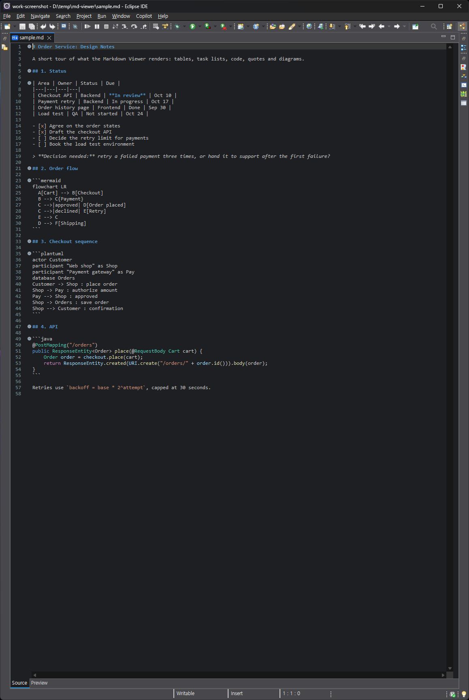
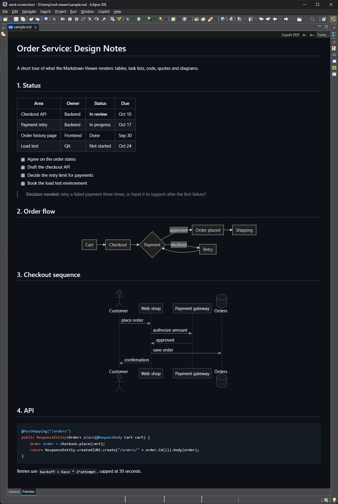
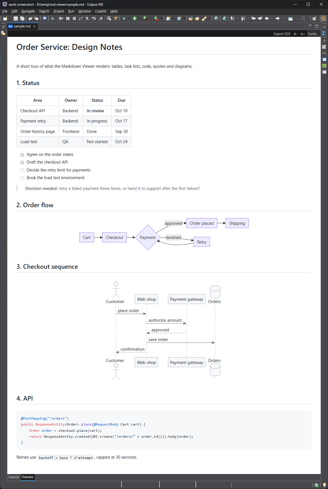
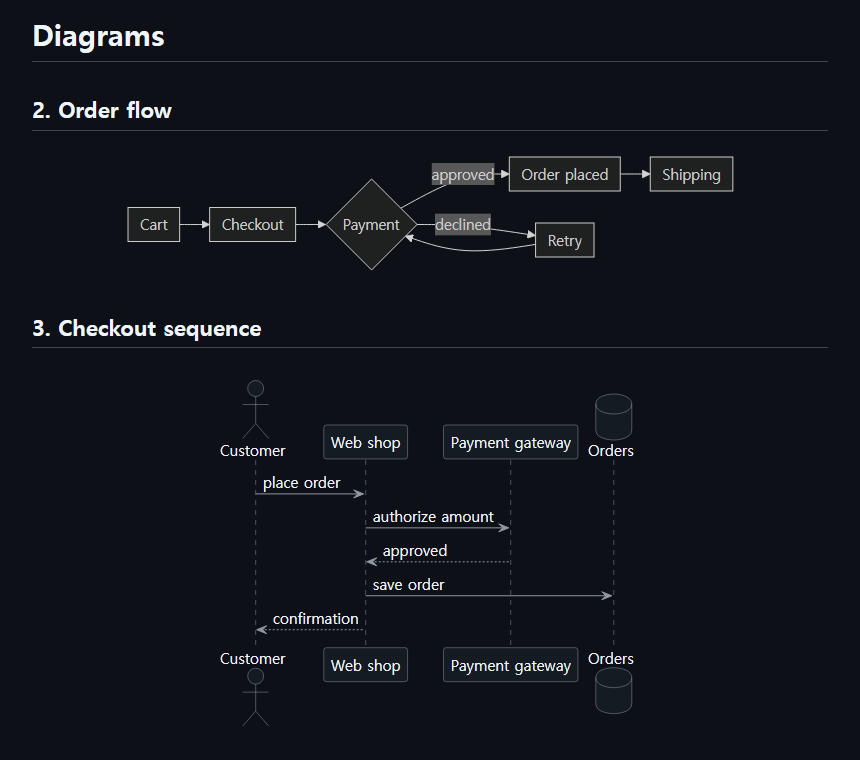
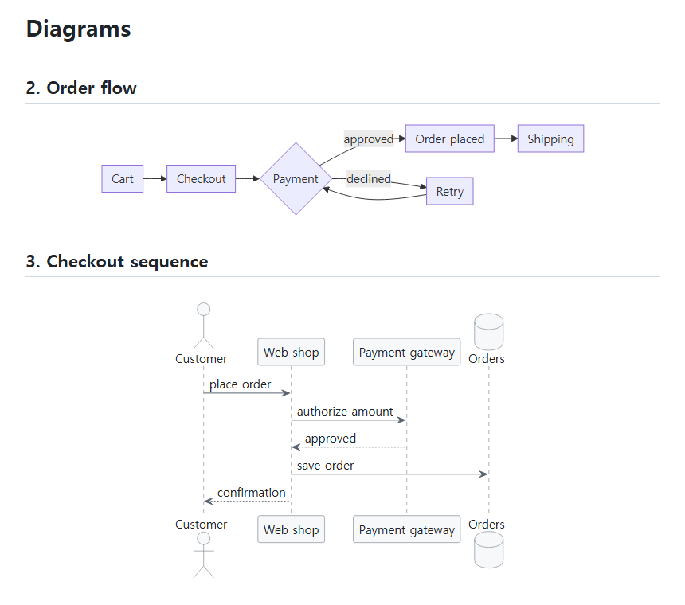
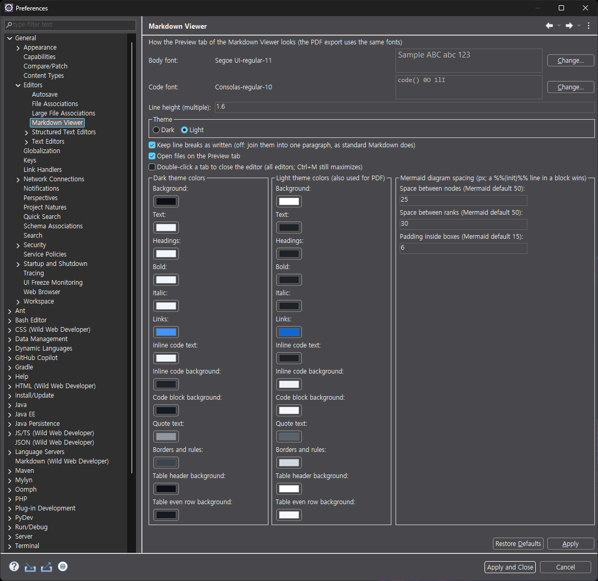

# Markdown Viewer for Eclipse

A Markdown editor for Eclipse with a preview tab.
Source and Preview are tabs of one editor, not a split screen or a separate view, so the document gets the whole editor area and a terminal or other views keep their room beside it.
It renders GitHub Flavored Markdown with the same parser VS Code uses (markdown-it), draws Mermaid and PlantUML diagrams and math, keeps the source and the preview at the same scroll position, and exports a PDF in one click.

[한국어 README](README.ko.md)

| Source tab | Preview tab, dark theme | Preview tab, light theme |
|---|---|---|
|  |  |  |

| Dark theme | Light theme (also used for PDF) |
|---|---|
|  |  |


The screenshots show [docs/sample.md](docs/sample.md) with the default settings, the math one [test/math.md](test/math.md).

## Features

| Feature | Details |
|---|---|
| Tabs | Source and Preview tabs in one editor area, each using its full width with no split screen, opening on Preview by default |
| Scroll sync | Switching tabs keeps the scrollbar position: at the bottom of one means at the bottom of the other |
| Rendering | GFM tables, task lists, syntax highlighting, heading anchors (table of contents links) |
| Front matter | A YAML block at the top of the file (`---` to `---`), as in SKILL.md files or static site pages, shows as a collapsed key/value table instead of a rule and bold text |
| Mermaid | ```` ```mermaid ```` blocks, with tighter default spacing and the preview's font |
| PlantUML | ```` ```plantuml ```` / ```` ```puml ```` blocks, drawn locally by the bundled PlantUML, no server, no Graphviz |
| Math | `$inline$`, `$$display$$` and ```` ```math ```` blocks as on GitHub, drawn offline by the bundled KaTeX; `\$` and prices such as $5 stay text, a TeX error shows in red |
| Images | PNG, GIF and SVG relative to the document, inline `<svg>` |
| Links | `.md`, `.markdown`, `.mdown`, `.mkd` links open in Eclipse, web and mail links in the system browser |
| PDF export | A4, light colors, diagrams and math included |
| Live reload | When the file changes on disk, for example written by an AI coding agent such as Claude Code or Codex CLI in a terminal, the Preview re-renders it within 0.3 s, diagrams included. Eclipse notices the change right away with Preferences > General > Workspace > Refresh using native hooks or polling; with unsaved edits in the editor, Eclipse asks before reloading |
| Font size | `A-` / `A+` on the preview toolbar |
| Preferences | Fonts, line height, line breaks, dark and light colors (GitHub colors by default), diagram spacing, optional double-click to close editor tabs |
| Offline | All JavaScript and PlantUML are inside the plugin JAR |
| Languages | English, Korean |

The Source tab is Eclipse's Generic Editor, so TM4E syntax highlighting and the Wild Web Developer Markdown language server keep working.

## Requirements

- Eclipse 2026-09 (4.41) or later with `org.eclipse.ui.genericeditor` (included in the Eclipse IDE packages)
- Windows 10 or 11 with Microsoft Edge (WebView2): everything, including the PDF export
- Linux: the preview works with WebKitGTK (`libwebkit2gtk-4.1`), checked on Ubuntu 24.04 under WSL; the PDF export does not (it uses Edge)

## Install

**Eclipse Marketplace:** drag the button onto a running Eclipse, or search for "Markdown Viewer" in Help > Eclipse Marketplace ([listing](https://marketplace.eclipse.org/content/markdown-viewer)).

[](https://marketplace.eclipse.org/marketplace-client-intro?mpc_install=7567639 "Drag to your running Eclipse workspace to install Markdown Viewer")

**Update site** (Eclipse can then update it with Help > Check for Updates):

1. Help > Install New Software > Work with: `https://insjang.github.io/eclipse-markdown-viewer/updates/` and press Enter.
2. Check **Markdown Viewer**, Next, accept the license, Finish.
   The plugin is not code-signed, so Eclipse asks whether to trust unsigned content: choose Trust Selected.
3. Restart Eclipse. `.md` files now open in the Markdown Viewer.

**Or a single JAR, no p2:**

1. Download `io.github.insjang.mdviewer_<version>.jar` from [Releases](https://github.com/insjang/eclipse-markdown-viewer/releases).
2. Close Eclipse and copy the JAR into the `dropins` folder of your Eclipse installation.
3. Start Eclipse.

If `.md` files still open in another editor: right-click the file > Open With > Markdown Viewer, or set it as the default under Preferences > General > Editors > File Associations > `*.md`.

To uninstall: Help > About Eclipse IDE > Installation Details > Installed Software > Markdown Viewer > Uninstall, or delete the JAR from `dropins`, then restart Eclipse.

## Build

JDK 21 or later and bash (WSL works).

```bash
ECLIPSE=/path/to/eclipse ./build.sh           # build/io.github.insjang.mdviewer_<version>.jar
ECLIPSE=/path/to/eclipse ./build.sh install   # also copy it into $ECLIPSE/dropins (close Eclipse first)
ECLIPSE=/path/to/eclipse ./build.sh site      # also build a p2 update site in build/site (feature/ holds feature.xml)
```

The first build downloads PlantUML (MIT build, 17 MB) from Maven Central and checks its SHA-1; it is not kept in git.
Every build gets a new version qualifier, so a plain restart picks up a replaced JAR.

## Preferences

Preferences > General > Editors > Markdown Viewer



| Setting | Default |
|---|---|
| Body font | Eclipse dialog font, 11 pt (Segoe UI on English Windows, Malgun Gothic on Korean Windows) |
| Code font | Eclipse text font, 10 pt (Consolas on Windows; ligatures are turned off in the preview) |
| Line height | 1.6 |
| Theme | Dark |
| Keep line breaks as written | On (off: standard Markdown, lines join into one paragraph) |
| Open files on the Preview tab | On |
| Double-click a tab to close the editor | Off (on: applies to every editor tab, instead of maximizing; Ctrl+M still maximizes) |
| Dark and light colors (13 each) | GitHub colors, `Restore Defaults` brings them back |
| Mermaid spacing: nodes, ranks, box padding | 25, 30, 6 px (Mermaid's own defaults are 50, 50, 15) |

- Indentation of lists, quotes and tabs in code is four characters of the code font.
- Diagrams use the body font and size; the PDF uses the light colors.
- A `%%{init: {...}}%%` line in a Mermaid block overrides the spacing for that diagram.

Math, as on GitHub:

````markdown
The roots of $ax^2 + bx + c = 0$ are

$$
x = \frac{-b \pm \sqrt{b^2 - 4ac}}{2a}
$$
````

## Security

Markdown from elsewhere can be opened safely.

- HTML in a document is sanitized with DOMPurify: scripts, event handlers and `javascript:` links are removed.
- Only `http`, `https`, `mailto`, document-relative paths and `#anchors` survive as URLs, and only `http`, `https` and `mailto` are handed to the operating system.
- Mermaid runs with `securityLevel: 'strict'`.
- KaTeX runs with `trust: false`: `\href`, `\url` and `\includegraphics` stay text.
- PlantUML runs with its `SANDBOX` security profile: `!include` cannot read local files or URLs. Its SVG output is sanitized too.
- Network paths (`\\host\share`, `//host/...`, `file://host/...`) are removed from images, links and styles, and a Mermaid diagram naming one is not drawn: on Windows, merely loading one would connect to that host and hand it the user's NTLM hash.

## Limitations

- PDF export is Windows only: the PDF is printed by headless Edge from `C:\Program Files (x86)` or `C:\Program Files`, and the button is hidden when it is not there. macOS is untested.
- No outline view.
- PlantUML's built-in layout engine (smetana) ignores spacing settings; its default layout is already compact.

## Source layout

```
src/io/github/insjang/mdviewer/
  MarkdownEditor.java          Source/Preview tabs, scroll sync, links, PDF export
  PlantUml.java                PlantUML blocks to SVG (font and colors, cache, sandbox)
  Activator.java               web assets, A-/A+
  PrefInit.java                preference defaults
  Colors.java                  colors per theme (GitHub defaults)
  MarkdownPreferencePage.java  preference page
  Contributor.java             undo, find and other editing actions
  TabClose.java                optional double-click on an editor tab to close it
  Messages.java, messages*.properties   UI text (English, Korean)
web/
  preview.html / .js / .css    rendering, sanitizing, scrolling, styles
  *.min.js, hl-*.css           bundled libraries
feature/                       feature.xml, category.xml for the update site
icons/                         editor icon
test/
  check.js                     rendering (node)
  sanitize.js, plantuml.js     sanitizing and PlantUML wiring (node + jsdom)
  math.js, math.md             math rendering and sanitizing (node + jsdom)
  JsEscape.java, PlantUmlCheck.java
```

## See also

[Modern Terminal](https://github.com/insjang/eclipse-modern-terminal) by the same author: a terminal view for Eclipse with Windows Terminal-style colors, wide (CJK) characters, mouse support for TUI apps, SSH with saved sessions and an SFTP Files view. Ctrl+click a `.md` path in it to open this viewer. [Eclipse Marketplace](https://marketplace.eclipse.org/content/modern-terminal)

## License

Developed with the help of AI coding assistants, including Claude (Anthropic).


[Eclipse Public License 2.0](LICENSE).
Bundled third-party libraries (markdown-it, markdown-it-task-lists, KaTeX, @vscode/markdown-it-katex, Mermaid, highlight.js, DOMPurify, PlantUML) keep their own licenses, listed in [NOTICE](NOTICE).
